# Administration API

The page explains how to deploy the Administration API and try out the flow.

1. Sign in to the API Publisher portal at `https:// <APIM_HOST>:9443/publisher` with `creator/publisher` privileges.

   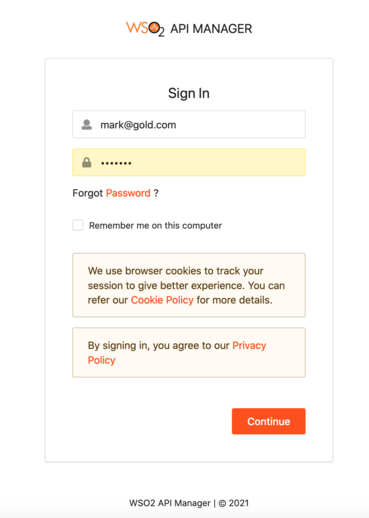

2. In the homepage, go to **REST API** and select **Import Open API**.

   

3. Select **OpenAPI File/Archive**. 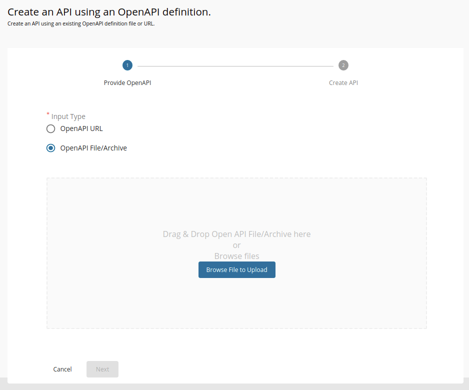

4. Click **Browse File to Upload** and select the `<APIM_HOME>/<OB_APIM_TOOLKIT_HOME>/repository/resources/apis/consumerdatastandards.org.au/CDSAdminAPIs/1.24.0/consumer-data-standards-admin-1.24.0.yaml` file.

5. Click **Next**.

6. Click **Create** to create the API

7. After the API is successfully created, go to **Portal Configurations** using the left menu panel. 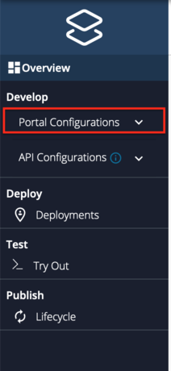

8. Select **Subscriptions** from the left menu pane and set the business plan to **Unlimited: Allows unlimited requests**. 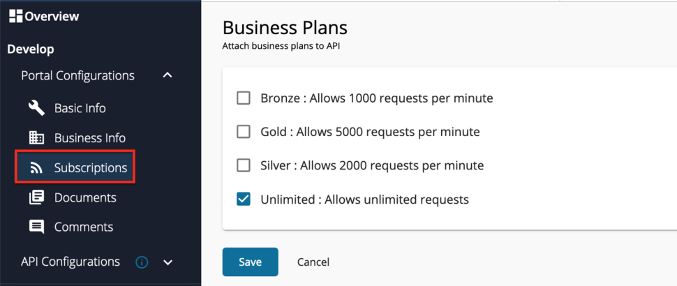

9. Click **Save**.

10. Go to **Develop -> API Configurations -> Policies** in the left menu pane to add a custom policy.<br /><br />

    

11. On the **Policy List** card, click on **Add New Policy**.

12. Fill in the **Create New Policy**.

13. Upload the `<APIM_HOME>/<OB_APIM_TOOLKIT_HOME>/repository/resources/apis/consumerdatastandards.org.au/CDSAdminAPIs/1.24.0/cds-admin-api-insequence-1.24.0.xml` file.

14. Scroll down and click **Save**. Upon successful creation of the policy, you receive an alert as shown below:<br /><br />

    

15. Expand the API endpoint you want from the list of API endpoints. For example: 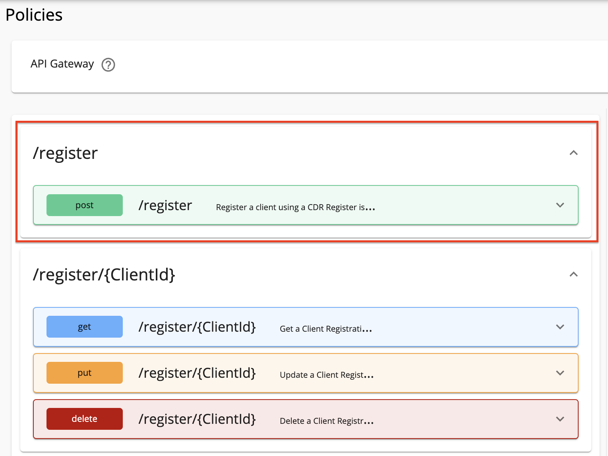

16. Expand the HTTP method from the API endpoint you selected. For example: 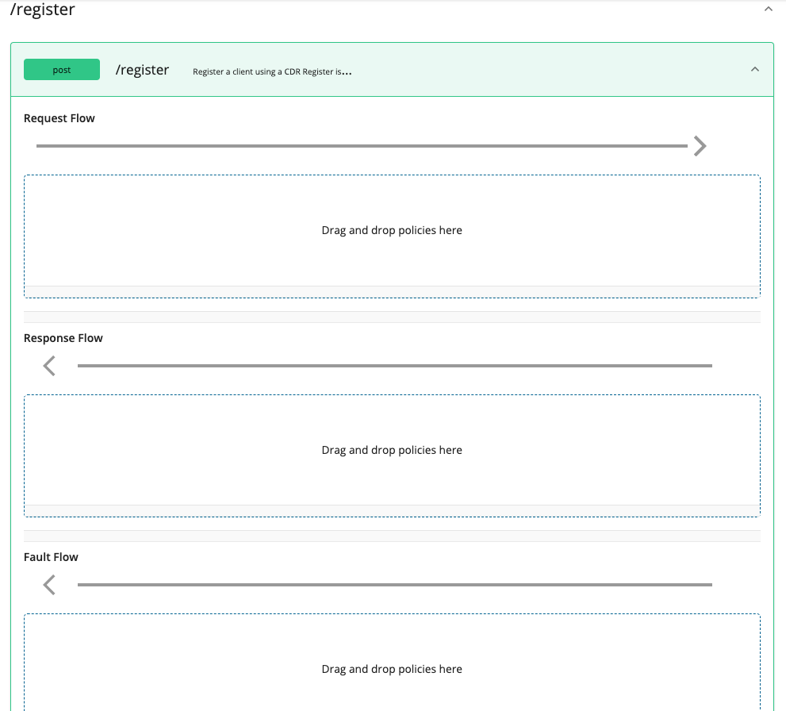

17. Drag and drop the previously created policy to the **Request Flow** of the API endpoint. 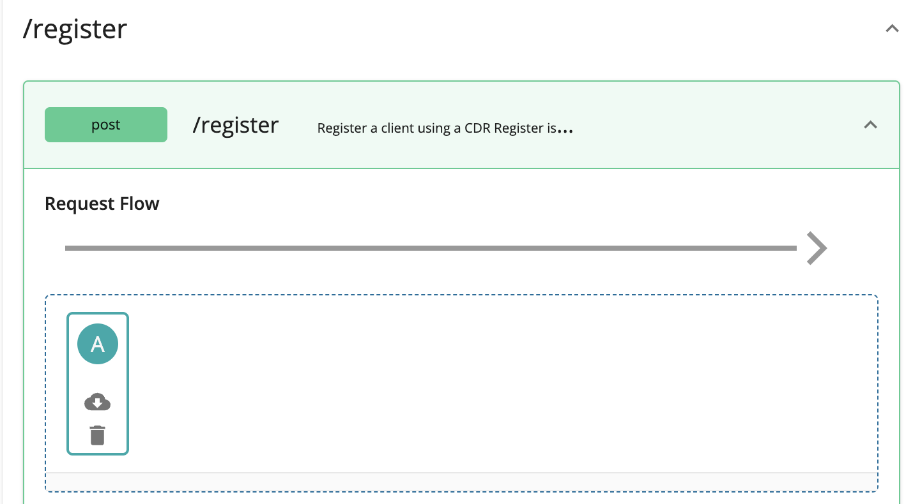

18. Select **Apply to all resources** and click **Save**.

19. Scroll down and click **Save**.

20. Use the left menu panel and go to **API Configurations > Endpoints**.

    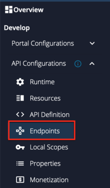

21. Add a **Dynamic Endpoint**. 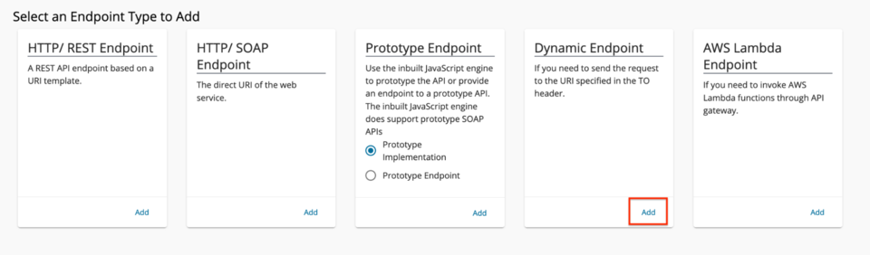

22. Go to **Deployments** using the left menu pane.

    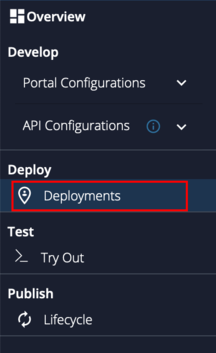

23. Select the API Gateway type

    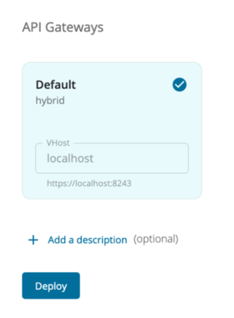

24. Click **Deploy**.

25. Go to **Overview** using the left menu pane.

    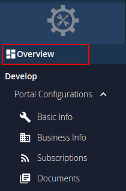

26. Click **Publish**.

    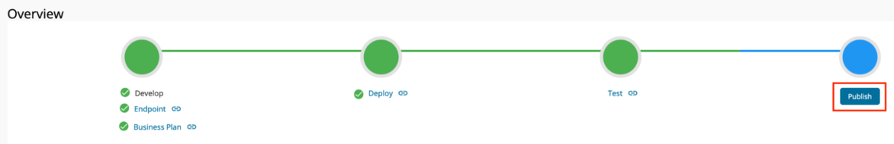

## Invoke Admin API[​](#invoke-admin-api "Direct link to Invoke Admin API")

### Get Metrics[​](#get-metrics "Direct link to Get Metrics")

**GET /admin/metrics**

This endpoint allows the Australian Competition & Consumer Commission to obtain operational statistics from the Data Holder on the operation of their CDR compliant implementation. The statistics obtainable from this endpoint are determined by the non-functional requirements for the CDR regime.

* Request
* Response

```
curl -k -X GET "https://<APIM_HOST>:8243/cds-au/v1/admin/metrics?period=ALL" -H "accept: application/json" -H "x-v: 1" -H "Authorization: Bearer <USER_ACCESS_TOKEN> "
```

```
{

  "data": {

    "requestTime": "string",

    "availability": {

      "currentMonth": 0,

      "previousMonths": [

        0

      ]

    },

    "performance": {

      "currentDay": 0,

      "previousDays": [

        0

      ]

    },

    "invocations": {

      "unauthenticated": {

        "currentDay": 0,

        "previousDays": [

          0

        ]

      },

      "highPriority": {

        "currentDay": 0,

        "previousDays": [

          0

        ]

      },

      "lowPriority": {

        "currentDay": 0,

        "previousDays": [

          0

        ]

      },

      "unattended": {

        "currentDay": 0,

        "previousDays": [

          0

        ]

      },

      "largePayload": {

        "currentDay": 0,

        "previousDays": [

          0

        ]

      },

      "secondary": {

        "currentDay": 0,

        "previousDays": [

          0

        ]

      },

      "largeSecondary": {

        "currentDay": 0,

        "previousDays": [

          0

        ]

      }

    },

    "averageResponse": {

      "unauthenticated": {

        "currentDay": 0,

        "previousDays": [

          0

        ]

      },

      "highPriority": {

        "currentDay": 0,

        "previousDays": [

          0

        ]

      },

      "lowPriority": {

        "currentDay": 0,

        "previousDays": [

          0

        ]

      },

      "unattended": {

        "currentDay": 0,

        "previousDays": [

          0

        ]

      },

      "largePayload": {

        "currentDay": 0,

        "previousDays": [

          0

        ]

      },

      "secondary": {

        "primary": {

          "currentDay": 0,

          "previousDays": [

            0

          ]

        },

        "secondary": {

          "currentDay": 0,

          "previousDays": [

            0

          ]

        }

      },

      "largeSecondary": {

        "primary": {

          "currentDay": 0,

          "previousDays": [

            0

          ]

        },

        "secondary": {

          "currentDay": 0,

          "previousDays": [

            0

          ]

        }

      }

    },

    "sessionCount": {

      "currentDay": 0,

      "previousDays": [

        0

      ]

    },

    "averageTps": {

      "currentDay": 0,

      "previousDays": [

        0

      ]

    },

    "peakTps": {

      "currentDay": 0,

      "previousDays": [

        0

      ]

    },

    "errors": {

      "currentDay": 0,

      "previousDays": [

        0

      ]

    },

    "rejections": {

      "authenticated": {

        "currentDay": 0,

        "previousDays": [

          0

        ]

      },

      "unauthenticated": {

        "currentDay": 0,

        "previousDays": [

          0

        ]

      }

    },

    "customerCount": 0,

    "recipientCount": 0,

    "secondaryHolder": {

      "errors": {

        "currentDay": 0,

        "previousDays": [

          0

        ]

      },

      "rejections": {

        "currentDay": 0,

        "previousDays": [

          0

        ]

      }

    }

  },

  "links": {

    "self": "string"

  },

  "meta": {}

}
```

tip

For more details on the response payload, see [Consumer Data Standards - Get Metrics](https://consumerdatastandardsaustralia.github.io/standards/#get-metrics).

### Metadata Update[​](#metadata-update "Direct link to Metadata Update")

**POST /admin/register/metadata**

The CDR Register invokes this endpoint to update the Data Holders regarding critical updates of the Accredited Data Recipients' metadata.

If the Data Holder supports Private Key JWT client authentication to authenticate the CDR Register, authorisation requires the following scope: [admin:metadata<!-- -->:update](https://consumerdatastandardsaustralia.github.io/standards/#authorisation-scopes). Otherwise, the scope is not applicable when the Data Holder supports Self-Signed JWT client authentication to authenticate the CDR Register.

note

This operation may only be called by the CDR Register.
